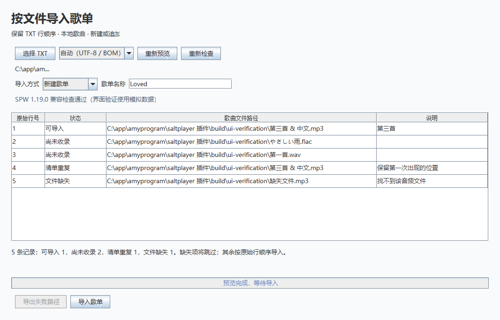
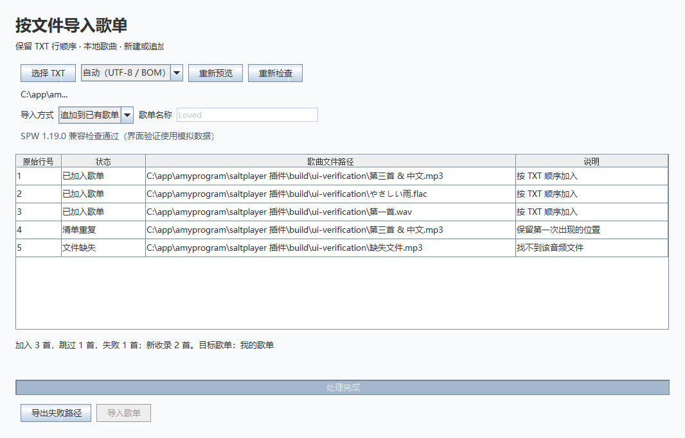

<div align="center">

[简体中文](README.md) | [繁體中文](README.zh-TW.md) | English

# SPW TXT Playlist Importer

**An open-source Salt Player for Windows (SPW 1.19.0) plugin to create or append playlists from TXT files of local audio paths in exact order.**

[](https://github.com/vanvan-program/spw-txt-playlist/releases)
[](#installation--usage)
[](#tech-stack--building-from-source)
[](LICENSE)

[Download (.spmod)](https://github.com/vanvan-program/spw-txt-playlist/releases) · [Verification Log (ZH)](docs/验证记录.md) · [Steam Workshop Guide (ZH)](docs/发布到Steam创意工坊.md) · [Issues](https://github.com/vanvan-program/spw-txt-playlist/issues)

</div>

---

## Overview

Reads a plain-text (`.txt`) file containing **one full local audio file path per line**, and either **creates a new playlist** or **appends to an existing playlist** in **Salt Player for Windows (SPW)** while preserving the exact line order.

> [!NOTE]
> This is an unofficial third-party open-source plugin targeting **Windows SPW 1.19.0** and verified host builds only. End-to-end acceptance inside the production player (install, import, and restart) is still pending; the current release is a pre-release.

## Screenshots

Rendered directly from the plugin window using mock library data. See the [verification log](docs/验证记录.md) for current validation status.





## Key Features

- **Exact-Order Create & Append**:
  - Creating a playlist defaults to the TXT file name and strictly follows the TXT line order.
  - Appending keeps the current display order of the existing playlist, appends only tracks not already present in TXT order, and switches to custom ascending sort. If all tracks already exist, the existing sort setting is untouched.
- **Encoding Detection & Preview**: Automatically detects UTF-8 and BOM-prefixed UTF-8 / UTF-16; legacy Chinese TXT files can switch to `GB18030` and re-preview.
- **Strict Path Validation & Deduplication**: Supports CRLF / LF, blank lines, and outer double quotes (up to 16 MB per TXT). Accepts absolute local paths only (no song title search, URLs, or relative paths). Duplicate paths or paths resolving to the same library track ID are added once.
- **Line-by-Line Diagnostics**: Missing, unreadable, unparseable, or ambiguous paths are reported individually without guessing by filename. Failed entries can be exported as UTF-8 TXT for fixing and re-importing.
- **Targeted Indexing & Transactional Safety**:
  - Unindexed files are added via SPW's `RepoService.addOrUpdateTracks` without full-disk scans.
  - Playlist creation/appending, ordering, and sort configuration execute inside a single Room / SQLite transaction with automatic rollback on failure.
  - 100% offline: never modifies audio files, never clears existing playlists, never touches "Favorites", and makes zero network requests.

## Installation & Usage

1. Download the `.spmod` package from [GitHub Releases](https://github.com/vanvan-program/spw-txt-playlist/releases).
2. In **SPW 1.19.0**, open **Workshop** and use local import to select the `.spmod` file.
3. Enable the plugin and grant **"Library Read"** and **"Host Modification (class-transform)"** permissions (required to interface with internal playlist APIs; v1 registers no UI hooks).
4. Open the plugin's **Settings** and click **Import TXT**. The window verifies the host version, key class SHA-256 fingerprints, and database schema before allowing writes.
5. Select your `.txt` file, review the parsed preview, choose **Create Playlist** or **Append to Existing Playlist**, and click **Import Playlist**.
6. Review line-by-line results and export failed paths to UTF-8 TXT if needed.

### Example TXT Format

```text
C:\Music\Track3.mp3
C:\Music\Track1.flac
C:\Music\Track2.wav
```

The created playlist order will be: `Track3` → `Track1` → `Track2`.

## Data Handling & Safety Boundaries

- Playlist writes reuse SPW's active Room connection, SQLite statements, and transactions rather than opening the user's database file separately. (Internal host APIs are not covered by official compatibility guarantees.)
- Append mode reads current order via the host's sort stream and re-checks playlist membership and sort state inside the transaction; if the target playlist changes concurrently, the import aborts safely.
- Closing the window or disabling the plugin cancels pending work: committed transactions persist while in-flight transactions roll back. Tracks indexed prior to the transaction remain in the library.
- Enabling the plugin never triggers an automatic import.

## Tech Stack & Building from Source

- **Stack**: Kotlin `2.4.20` · JDK `25` · Gradle `9.8.0` Wrapper · SPW Workshop API & Gradle Plugin `0.1.0-dev22`
- **Build** (first build requires internet access to Maven Central, Gradle, and JitPack; runtime is fully offline):

```powershell
$env:JAVA_HOME = 'path\to\jdk-25'
.\scripts\build.ps1
# Offline build once dependencies are cached:
.\scripts\build.ps1 -Offline
```

- **Artifacts**:
  - Raw build: `build/libs/plugin-io.github.localplaylist.txtimport-1.0.0.spmod`
  - Release copy: `dist/按文件导入歌单-1.0.0.spmod`
- **Unit tests**:

```powershell
.\gradlew.bat test
```

- **Isolated host integration tests** (against a local SPW 1.19.0 installation):

```powershell
.\gradlew.bat hostIntegration '-PspwHome=C:\app\steam\steamapps\common\Salt Player for Windows'
```

> Integration tests run in an isolated JVM under `build/host-test/` with in-memory Preferences and never touch real user playlists. `src/main/resources/host-119.properties` pins SHA-256 fingerprints of critical host classes—do not bypass this check on host updates; instead re-verify APIs and run integration tests.

### Official References

- [SPW Workshop API Repository](https://github.com/Moriafly/spw-workshop-api)
- [Salt Player Workshop Getting Started](https://saltplayer.com/workshop/getting-started)
- [Permissions Documentation](https://saltplayer.com/workshop/permissions.html)

## Feedback & License

- Please report issues via [GitHub Issues](https://github.com/vanvan-program/spw-txt-playlist/issues) with your SPW version, OS version, and error details (redact personal paths and track lists before attaching logs).
- This repository does not distribute SPW binaries, decompiled host files, or audio files.
- Licensed under the **[MIT License](LICENSE)**. See [THIRD_PARTY_NOTICES.md](THIRD_PARTY_NOTICES.md) for third-party attributions.
