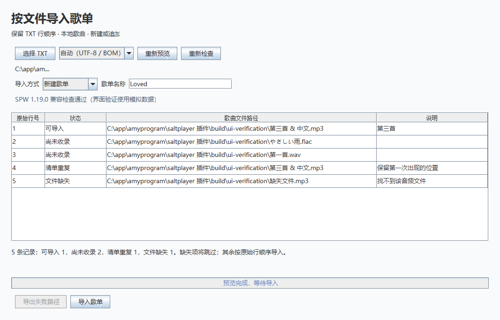
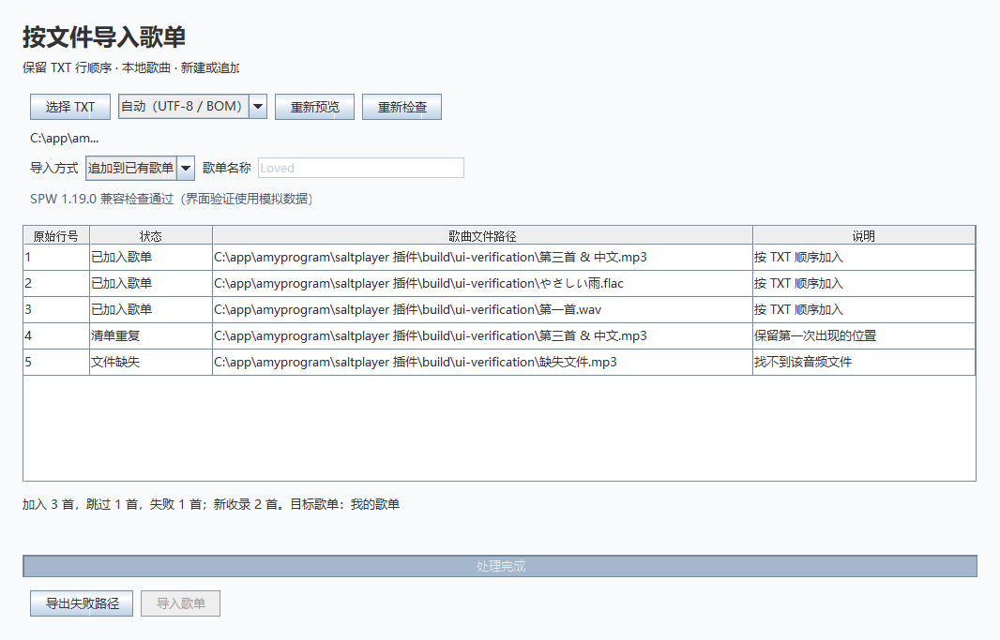

<div align="center">

简体中文 | [繁體中文](README.zh-TW.md) | [English](README.en.md)

# SPW 按文件导入歌单

**Salt Player for Windows (SPW 1.19.0) 第三方开源插件：按 TXT 本地音频路径顺序新建或追加歌单**

[](https://github.com/vanvan-program/spw-txt-playlist/releases)
[](#安装与使用)
[](#开发构建)
[](LICENSE)

[下载插件（Releases）](https://github.com/vanvan-program/spw-txt-playlist/releases) · [验证记录](docs/验证记录.md) · [Steam 创意工坊发布步骤](docs/发布到Steam创意工坊.md) · [问题反馈](https://github.com/vanvan-program/spw-txt-playlist/issues)

</div>

---

## 项目定位

读取“一行一个本地音频文件完整路径”的 TXT 文本文件，严格按照行顺序在 **Salt Player for Windows (SPW)** 中**新建歌单**，或**追加到已有歌单**。

> [!NOTE]
> 本项目为第三方开源插件，仅适配 **Windows 版 SPW 1.19.0** 及已校验的宿主构建。正式播放器内的安装、导入和重启验收尚待完成，当前发布为预发布版本。

## 窗口预览

以下图片由插件实际窗口绘制（使用模拟曲库数据）；正式播放器内的验收状态见 [验证记录](docs/验证记录.md)。





## 核心功能

- **严格保序新建与追加**：
  - 新建歌单默认使用 TXT 文件名作为歌单名，按 TXT 原始行顺序排列。
  - 追加歌单保留原歌单当前显示顺序，仅将尚未存在的新歌按 TXT 顺序追加到末尾，并切换为自定义升序；全部歌曲已存在时不改动原排序。
- **多编码自动识别与预览**：默认支持 UTF-8、带 BOM 的 UTF-8 / UTF-16，旧版中文 TXT 可手动切换 `GB18030` 后重新预览。
- **严谨的路径校验与去重**：支持 CRLF / LF、空行及外层双引号（单文件最大 16 MB）；仅接受完整本地路径（不支持歌名搜索、下载链接或相对路径）。TXT 重复路径或映射至同一曲库歌曲 ID 时仅加入一次。
- **逐行结果报告与失败导出**：缺失、不可读、无法解析或路径不唯一的条目逐行报告（不按同名文件猜测），失败项可导出为 UTF-8 TXT 修正后再次导入。
- **按需入库与事务安全**：
  - 尚未收录的本地文件调用 SPW 的 `RepoService.addOrUpdateTracks` 定向收录，不扫描整盘。
  - 歌单写入、顺序保存与排序设置在同一 Room / SQLite 事务中提交，异常自动回滚。
  - 完全离线运行：不修改音频文件、不清空已有歌单、不改动“我喜欢”、不联网也不上传任何清单。

## 安装与使用

1. 前往 [GitHub Releases](https://github.com/vanvan-program/spw-txt-playlist/releases) 下载 `.spmod` 插件包。
2. 在 **SPW 1.19.0** 的「创意工坊」中，使用本地导入功能选择 `.spmod` 文件。
3. 启用插件，勾选 **「曲库读取」** 与 **「宿主修改（class-transform）」** 权限（用于适配歌单内部接口；第一版不注册 UI Hook）。
4. 打开本插件的「配置」，点击「导入 TXT」。窗口会自动校验宿主版本、关键类指纹及数据库结构，校验不通过时将禁用导入。
5. 选择 TXT 文件并检查预览状态，选择「新建歌单」或「追加到已有歌单」，点击「导入歌单」。
6. 查看逐行处理结果；如有失败项可导出 UTF-8 TXT 修正后重试。

### TXT 文件格式示例

```text
C:\Music\第三首.mp3
C:\Music\第一首.flac
C:\Music\第二首.wav
```

新建歌单后的曲目顺序即为：`第三首` → `第一首` → `第二首`。

## 数据处理与安全边界

- 歌单变更通过 SPW 当前持有的 Room 连接、SQLite 语句和事务提交，不另行打开或直接写入用户数据库文件（内部 API 不受官方兼容承诺保护）。
- 追加模式使用宿主自身排序流读取当前顺序，并在事务内二次检查歌曲关联与排序设置；期间目标歌单变化时自动停止，提示重新预览后再试。
- 关闭窗口或停用插件会取消未完成任务：已提交的事务保留，进行中的事务遇到取消会回滚；事务前已收录到曲库的音频仍保留在曲库中。
- 插件启用后不会自动执行导入。

## 技术栈与开发构建

- **技术栈**：Kotlin `2.4.20` · JDK `25` · Gradle `9.8.0` Wrapper · SPW Workshop API & Gradle Plugin `0.1.0-dev22`
- **构建方式**（首次构建需访问 Maven Central、Gradle 与 JitPack；插件运行完全离线）：

```powershell
$env:JAVA_HOME = '你的 JDK 25 目录'
.\scripts\build.ps1
# 依赖已缓存后可离线构建：
.\scripts\build.ps1 -Offline
```

- **构建产物**：
  - 原始产物：`build/libs/plugin-io.github.localplaylist.txtimport-1.0.0.spmod`
  - 发布副本：`dist/按文件导入歌单-1.0.0.spmod`
- **运行单元测试**：

```powershell
.\gradlew.bat test
```

- **运行宿主隔离集成测试**（基于本机 SPW 1.19.0 真实类）：

```powershell
.\gradlew.bat hostIntegration '-PspwHome=C:\app\steam\steamapps\common\Salt Player for Windows'
```

> 集成测试在独立 JVM 及 `build/host-test/` 目录中运行并使用内存 Preferences，不访问正式用户歌单。`src/main/resources/host-119.properties` 锁定了受支持宿主的关键类 SHA-256 指纹；宿主更新或实现变更时会停止写入，请勿移除指纹检查，而应重新核验接口并执行集成测试。

### 官方参考资料

- [SPW Workshop API 仓库](https://github.com/Moriafly/spw-workshop-api)
- [Salt Player 创意工坊开发入门](https://saltplayer.com/workshop/getting-started)
- [权限说明](https://saltplayer.com/workshop/permissions.html)

## 反馈与开源协议

- 问题反馈请提交 [GitHub Issues](https://github.com/vanvan-program/spw-txt-playlist/issues)，并注明 SPW 版本、系统版本与错误提示（附日志前请隐去个人路径与曲目清单）。
- 本项目不分发 SPW 宿主程序、宿主反编译文件或任何音频文件。
- 源码采用 **[MIT License](LICENSE)** 开源，第三方依赖声明见 [THIRD_PARTY_NOTICES.md](THIRD_PARTY_NOTICES.md)。
