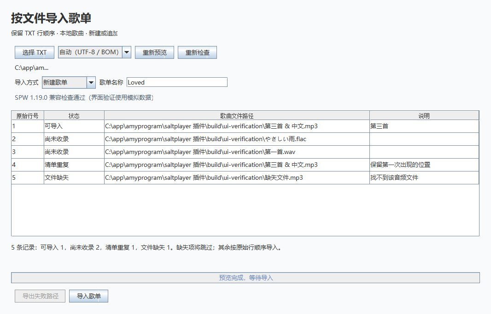
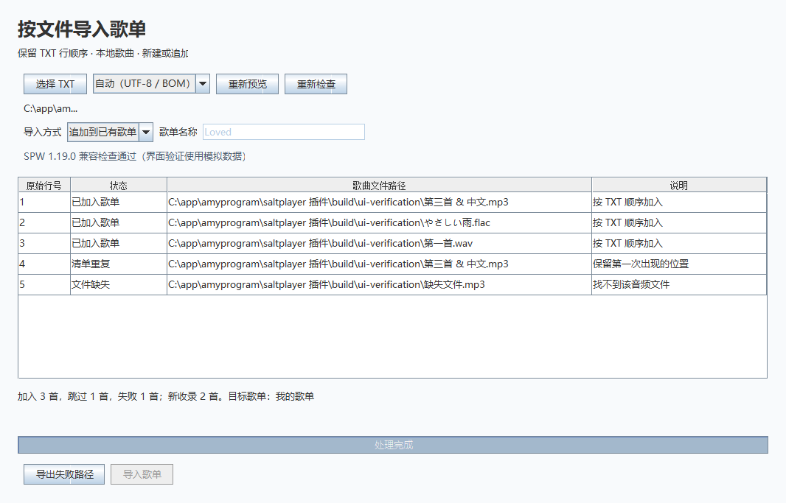

# SPW 按文件导入歌单

读取“一行一个本地音频文件完整路径”的 TXT，按行顺序新建歌单，或追加到已有歌单。

第三方开源插件，仅适配 **Windows 版 SPW 1.19.0** 及已校验的宿主构建。正式播放器内的安装、导入和重启验收尚待完成，当前发布为预发布版本。

- [下载插件（GitHub Releases）](https://github.com/vanvan-program/spw-txt-playlist/releases)
- [源代码](https://github.com/vanvan-program/spw-txt-playlist) · [MIT 许可证](LICENSE) · [第三方说明](THIRD_PARTY_NOTICES.md)
- [Steam 创意工坊发布步骤](docs/发布到Steam创意工坊.md)

## 安装与使用

1. 在 SPW 1.19.0 的「创意工坊」中，使用本地导入功能选择 `.spmod` 文件。
2. 启用插件，勾选「曲库读取」和「宿主修改（class-transform）」权限。宿主修改权限用于适配歌单内部接口；第一版不注册 UI Hook。
3. 打开本插件的「配置」，点击「导入 TXT」。窗口会先检查宿主版本、关键类指纹及数据库结构；检查失败时禁用导入。
4. 选择 TXT，检查预览中的路径和状态。默认识别 UTF-8、带 BOM 的 UTF-8 / UTF-16；旧版中文 TXT 可以选择 GB18030 后重新预览。
5. 选择「新建歌单」并填写名称，或选择「追加到已有歌单」，点击「导入歌单」。新歌单默认名称取 TXT 文件名。
6. 查看逐行处理结果。失败项可导出为 UTF-8 TXT，修正路径后再次导入。

文件格式示例：

```text
C:\Music\第三首.mp3
C:\Music\第一首.flac
C:\Music\第二首.wav
```

新歌单顺序就是第三首、第一首、第二首。TXT 支持 CRLF / LF、空行和外层双引号；只接受完整本地路径，不支持歌名搜索、下载链接或相对路径。最多读取 16 MB 的单个 TXT。

追加会保留原歌单当前显示的顺序，只把尚未存在的新歌按 TXT 顺序放到末尾，并切换到自定义升序。全部歌曲都已存在时，不改变原歌单排序设置。TXT 重复路径保留第一次；不同路径对应同一曲库歌曲 ID 时也仅加入一次。

## 窗口预览

以下图片由插件实际窗口绘制，使用模拟曲库数据；正式播放器内的验收状态见[验证记录](docs/验证记录.md)。





## 数据处理

- 文件尚未收录时，调用 SPW 的 `RepoService.addOrUpdateTracks`，只处理指定文件，不扫描整盘。
- 缺失、不可读取、不能解析或路径不唯一的歌曲逐行报告，不按同名文件猜测。
- 歌单变更通过 SPW 当前持有的 Room 连接、SQLite 语句和事务提交，不另行打开或直接写入用户数据库文件。内部 API 不受官方兼容承诺保护。
- 新建和追加的歌单写入、顺序保存、排序设置在同一事务中完成；异常回滚。事务前已成功收录的音频仍保留在曲库中。
- 追加使用宿主自己的排序流读取当前顺序；事务内再次检查歌曲关联及排序设置。期间目标内容变化时停止，重新预览后再试。
- 不修改音频文件，不清空已有歌单，不修改“我喜欢”，不联网，不上传歌曲清单。插件启用不会自动导入。
- 关闭窗口会取消尚未完成的任务。已经完成的事务保留；进行中的事务遇到取消会回滚。停用插件会关闭窗口并取消后台任务。

## 开发构建

依赖：JDK 25、Gradle 9.8.0 Wrapper、Kotlin 2.4.20、Workshop API 和 Gradle 插件 0.1.0-dev22。构建首次需要访问 Maven Central、Gradle 和 JitPack；插件运行离线。

```powershell
$env:JAVA_HOME = '你的 JDK 25 目录'
.\scripts\build.ps1
# 依赖已缓存后：
.\scripts\build.ps1 -Offline
```

原始产物位于 `build/libs/plugin-io.github.localplaylist.txtimport-1.0.0.spmod`，发布副本位于 `dist/按文件导入歌单-1.0.0.spmod`。

只运行单元测试：`./gradlew.bat test`。

在本机 SPW 1.19.0 的真实类上运行隔离集成测试：

```powershell
.\gradlew.bat hostIntegration '-PspwHome=C:\app\steam\steamapps\common\Salt Player for Windows'
```

集成测试在独立 JVM 和 `build/host-test/` 下创建数据库、音频和配置目录，使用内存 Preferences，不访问正式用户歌单。测试中的静态替换辅助类只位于测试源码，绝不打入插件。

`src/main/resources/host-119.properties` 固定了受支持宿主的关键类 SHA-256。宿主更新或同版本内部实现不同会停止写入；不要通过移除指纹检查强行兼容，应重新检查接口并执行集成测试。

官方资料：[API 仓库](https://github.com/Moriafly/spw-workshop-api)、[开发入门](https://saltplayer.com/workshop/getting-started)、[权限说明](https://saltplayer.com/workshop/permissions.html)。

已执行的测试及尚未完成的正式播放器验收见 [验证记录](docs/验证记录.md)。

## 反馈与兼容性

请通过 [Issues](https://github.com/vanvan-program/spw-txt-playlist/issues) 提供 SPW 版本、系统和错误提示。附日志前请隐去个人文件路径、歌曲清单和其他私人信息。项目不分发 SPW 宿主程序、宿主反编译文件或音频文件。
