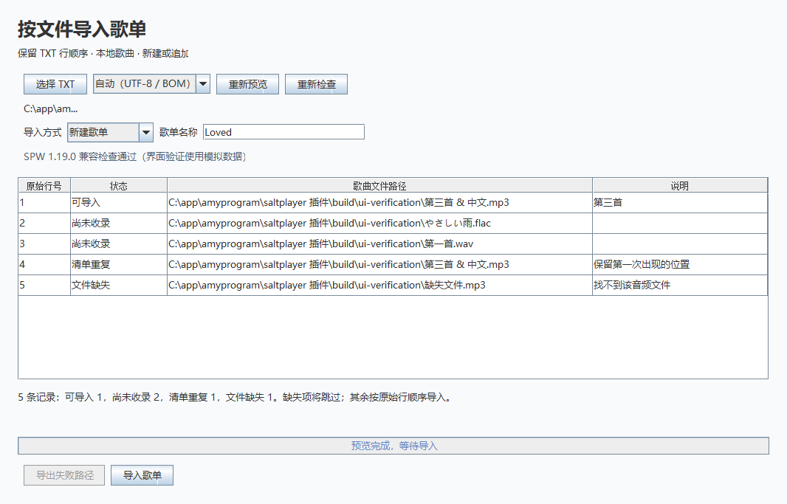
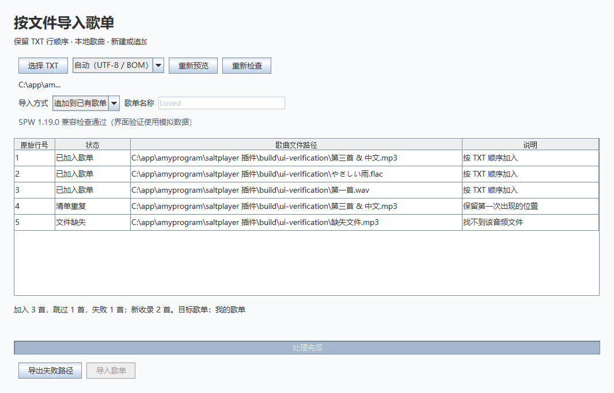

<div align="center">

[简体中文](README.md) | 繁體中文 | [English](README.en.md)

# SPW 按檔案匯入歌單

**Salt Player for Windows (SPW 1.19.0) 第三方開源外掛：依 TXT 本機音訊路徑順序建立或追加歌單**

[](https://github.com/vanvan-program/spw-txt-playlist/releases)
[](#安裝與使用)
[](#技術棧與開發建置)
[](LICENSE)

[下載外掛（Releases）](https://github.com/vanvan-program/spw-txt-playlist/releases) · [驗證紀錄](docs/验证记录.md) · [Steam 工作坊發布步驟](docs/发布到Steam创意工坊.md) · [問題回報](https://github.com/vanvan-program/spw-txt-playlist/issues)

</div>

---

## 專案定位

讀取「每行一個本機音訊檔案完整路徑」的 TXT 純文字檔，嚴格依照行順序在 **Salt Player for Windows (SPW)** 中**建立新歌單**，或**追加至既有歌單**。

> [!NOTE]
> 本專案為第三方開源外掛，僅適配 **Windows 版 SPW 1.19.0** 及已校驗的宿主建置版本。正式播放器內的安裝、匯入與重啟驗收尚待完成，目前發布為預覽版。

## 視窗預覽

以下圖片由外掛實際視窗繪製（使用模擬曲庫資料）；正式播放器內的驗收狀態請參閱 [驗證紀錄](docs/验证记录.md)。





## 核心功能

- **嚴格保序建立與追加**：
  - 建立新歌單預設以 TXT 檔名作為歌單名稱，完全保留 TXT 原始行順序。
  - 追加至既有歌單會保留原歌單目前顯示順序，僅將尚未存在的新曲目依 TXT 順序追加至尾端，並切換為自訂升冪；若所有曲目皆已存在則不更動原排序。
- **多編碼自動識別與預覽**：預設支援 UTF-8、含 BOM 的 UTF-8 / UTF-16；舊版中文 TXT 可手動切換 `GB18030` 後重新預覽。
- **嚴謹的路徑檢查與去重**：支援 CRLF / LF、空行與外層雙引號（單檔上限 16 MB）；僅接受完整本機路徑（不支援歌名搜尋、下載連結或相對路徑）。重複路徑或對應同一曲庫歌曲 ID 時僅加入一次。
- **逐行結果回報與失敗匯出**：遺失、無法讀取、無法解析或路徑不唯一的項目會逐行回報（不依同名檔案猜測），失敗項目可匯出為 UTF-8 TXT 修正後重新匯入。
- **按需收錄與交易安全**：
  - 尚未收錄的本機音訊透過 SPW 的 `RepoService.addOrUpdateTracks` 定向收錄，不掃描整顆磁碟。
  - 歌單寫入、順序儲存與排序設定於同一 Room / SQLite 交易中提交，發生例外自動回復（Rollback）。
  - 完全離線運作：不修改音訊檔案、不清空既有歌單、不更動「我喜歡」、不連線亦不上傳任何歌單資訊。

## 安裝與使用

1. 前往 [GitHub Releases](https://github.com/vanvan-program/spw-txt-playlist/releases) 下載 `.spmod` 外掛封裝檔。
2. 在 **SPW 1.19.0** 的「工作坊」中使用本機匯入功能選取 `.spmod` 檔案。
3. 啟用外掛並勾選 **「曲庫讀取」** 與 **「宿主修改（class-transform）」** 權限（用於呼叫歌單內部介面；第一版不註冊 UI Hook）。
4. 開啟本外掛的「設定」，點擊「匯入 TXT」。視窗會自動檢查宿主版本、關鍵類別指紋與資料庫結構，檢查失敗時將停用匯入。
5. 選取 TXT 檔案並確認預覽狀態，選擇「建立新歌單」或「追加至既有歌單」，點擊「匯入歌單」。
6. 檢視逐行處理結果；若有失敗項目可匯出 UTF-8 TXT 修正後再次匯入。

### TXT 檔案格式範例

```text
C:\Music\第三首.mp3
C:\Music\第一首.flac
C:\Music\第二首.wav
```

建立後的新歌單順序即為：`第三首` → `第一首` → `第二首`。

## 資料處理與安全邊界

- 歌單變更透過 SPW 目前持有的 Room 連線、SQLite 陳述式與交易提交，不另行開啟或直接寫入使用者資料庫檔案（內部 API 不受官方相容性承諾保護）。
- 追加模式以宿主自身排序串流讀取現行順序，並在交易內再次檢查歌曲關聯與排序設定；若期間目標歌單有所變動則自動中止，提示重新預覽後再試。
- 關閉視窗或停用外掛會取消未完成的工作：已提交的交易會保留，進行中的交易遇取消會回復；交易前已收錄至曲庫的音訊仍保留於曲庫中。
- 啟用外掛後不會自動執行匯入。

## 技術棧與開發建置

- **技術棧**：Kotlin `2.4.20` · JDK `25` · Gradle `9.8.0` Wrapper · SPW Workshop API & Gradle Plugin `0.1.0-dev22`
- **建置方式**（首次建置需連線至 Maven Central、Gradle 與 JitPack；外掛執行完全離線）：

```powershell
$env:JAVA_HOME = '你的 JDK 25 目錄'
.\scripts\build.ps1
# 相依套件快取後可離線建置：
.\scripts\build.ps1 -Offline
```

- **建置產物**：
  - 原始產物：`build/libs/plugin-io.github.localplaylist.txtimport-1.0.0.spmod`
  - 發布複本：`dist/按文件导入歌单-1.0.0.spmod`
- **執行單元測試**：

```powershell
.\gradlew.bat test
```

- **執行宿主隔離整合測試**（基於本機 SPW 1.19.0 真實類別）：

```powershell
.\gradlew.bat hostIntegration '-PspwHome=C:\app\steam\steamapps\common\Salt Player for Windows'
```

> 整合測試於獨立 JVM 及 `build/host-test/` 目錄執行並使用記憶體 Preferences，不存取正式使用者歌單。`src/main/resources/host-119.properties` 鎖定了受支援宿主的關鍵類別 SHA-256 指紋；宿主更新或內部實作變更時會停止寫入，請勿移除指紋檢查，而應重新檢視介面並執行整合測試。

### 官方參考資料

- [SPW Workshop API 儲存庫](https://github.com/Moriafly/spw-workshop-api)
- [Salt Player 工作坊開發入門](https://saltplayer.com/workshop/getting-started)
- [權限說明](https://saltplayer.com/workshop/permissions.html)

## 回報與開源授權

- 問題回報請提交 [GitHub Issues](https://github.com/vanvan-program/spw-txt-playlist/issues)，並附上 SPW 版本、作業系統版本與錯誤訊息（檢附日誌前請隱去個人路徑與曲目清單）。
- 本專案不分發 SPW 宿主程式、宿主反編譯檔案或任何音訊檔案。
- 原始碼採用 **[MIT License](LICENSE)** 授權，第三方相依套件聲明請見 [THIRD_PARTY_NOTICES.md](THIRD_PARTY_NOTICES.md)。
